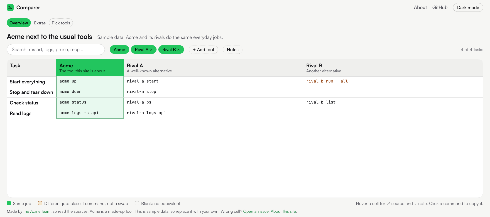

# Comparer

A template for a searchable, side-by-side table of the commands different tools give you for the same tasks. The data is YAML, the site is Jekyll, and it publishes on GitHub Pages. Every cell has a link to the official docs behind it.

Sites made from it: [cmd.flisk.sh](https://cmd.flisk.sh) ([flisk-sh/command-comparer](https://github.com/flisk-sh/command-comparer)). The sample site in this repo is at <https://flisk-sh.github.io/comparer/>.

<p align="center">
  <a href="https://flisk-sh.github.io/comparer/">
    <picture>
      <source media="(prefers-color-scheme: dark)" srcset="docs/screenshot-dark.png">
      
    </picture>
  </a>
</p>

## What you get

- **Tabs.** One page per comparison, built from a YAML list. Add a tab with a data file, no page file.
- **A clean table.** Plain command text, the primary tool in an accent column, amber for "closest command, different job", blank for "no equivalent". The header row and the first column stay in view while the table scrolls. Click a command to copy it. Hover a cell for its source and note.
- **Pick tools.** A page where visitors choose any set of tools to compare. The link keeps their picks.
- **Search, tool chips, notes.** Filter rows, hide or show columns, open every note at once.
- **Light and dark themes, and a phone layout** (one card per task).
- **A check script and CI.** The data is checked on every push, the site is built and deployed, and a weekly run checks that every source link still loads.

## Use this template

1. Click **Use this template**, or run `gh repo create my-comparer --template flisk-sh/comparer --public --clone`.
2. Open `_config.yml`: set `url`, `baseurl` and `repo_url`.
3. Open `_data/meta.yml`: name your primary tool and the maintainer.
4. Replace the sample tools, tabs and rows in `_data/` (format below).
5. Run `ruby scripts/check-data.rb` until it says OK.
6. In the repo's **Settings, Pages**, set **Source** to **GitHub Actions**. Push to `main`. The workflow checks, builds and deploys.

## Data format

Everything you write is in `_data/`:

| File | What it holds |
| --- | --- |
| `meta.yml` | The primary tool, the maintainer, the footer and About text, the date and version the commands were checked against |
| `tools.yml` | Every tool that can be a column: `name`, `tagline`, `site`, `docs` |
| `tabs.yml` | The tabs in order: `id`, `name`, `title`, `blurb` and the `tools` that are columns. The primary tool is always first |
| `compare/<tab id>.yml` | The rows and cells of one tab |

A row, with its cells keyed by tool id:

```yaml
tasks:
  - id: restart
    task: Restart one service
    keywords: reload rebuild trigger
    cells:
      acme:
        cmd: acme restart api
        source: https://example.com/docs/restart
      rival-b:
        status: none
        note: No per-service restart.
        source: https://example.com/docs/commands
```

| Field | Meaning |
| --- | --- |
| `cmd` | The command, as a string or a list of strings. Leave it out for `none` and `na`. |
| `status` | `match` (default) does the same job. `partial` is the closest command but a different job (shown amber). `none` has no equivalent (shown blank). `na` is not needed for this tool (also blank). |
| `note` | Optional. Under 110 characters. Shown behind the cell's i icon or the Notes toggle. Required for `partial`. |
| `source` | An `https` URL to the official docs or source. Required on every cell, including `none`: point it at the command reference that shows the absence. |

Rules that keep a comparison honest:

- A command for the primary tool must be a real one. Check it against the tool itself.
- Another tool's command must come from that tool's official docs, linked in `source`.
- If a tool has no command for the task, write `status: none`. Do not fill the cell with a guess.

## Check the data

Needs Ruby 2.6 or newer and nothing else.

```bash
ruby scripts/check-data.rb                  # structure: a cell per task and tool, an https source on every cell, no TODO
ruby scripts/check-data.rb --tab overview   # one tab only
ruby scripts/check-data.rb --cli            # also run the primary tool's commands against its installed CLI
ruby scripts/check-data.rb --links          # also fetch every source URL and expect a 2xx
```

`--cli` uses `primary_cli` (or `primary`) from `meta.yml` as the command name. For each of the primary tool's commands it checks that the subcommand and every flag appear in `<cli> ... --help`. `--links` runs weekly in CI. A cell can be left as `TODO` while you work; the check fails until it is filled, and `--todo-ok` lets you run it mid-way.

## Preview

With Ruby 3.x and Bundler:

```bash
bundle install
bundle exec jekyll serve
```

Open the address it prints, with your `baseurl` on the end.

With Docker only:

```bash
docker run --rm -p 4000:4000 -v "$PWD":/site -w /site ruby:3.3 \
  bash -c "bundle install && bundle exec jekyll serve --host 0.0.0.0"
```

## Custom domain

1. In your DNS provider, add a `CNAME` record from the name you want (for example `compare`) to `OWNER.github.io`. Leave it DNS only until GitHub has issued the certificate.
2. In **Settings, Pages**, set the custom domain, and turn on **Enforce HTTPS** once the certificate is ready.
3. In `_config.yml`, set `url` to `https://your.domain` and `baseurl` to `""`. Add a `CNAME` file with the domain so the repo records it.

## Update the engine

The look and the behavior (layouts, scripts, styles, the check script, the workflows) come from this template. To pick up improvements in a site made from it:

```bash
scripts/sync-template.sh            # from flisk-sh/comparer@main
git diff                            # review
ruby scripts/check-data.rb
```

It copies only the paths listed in `.comparer-engine`, and records the version in `.comparer-version`. Your `_config.yml`, `_data/`, `README.md`, `LICENSE`, `CNAME`, `assets/favicon.svg` and `docs/` are never touched. A site made from the template has no other link to it, so run the script now and then.

## Change the look

Colors are CSS variables in the `:root` blocks at the top of `assets/css/style.css` (light, and dark twice: once for the system setting and once for the toggle). Replace `assets/favicon.svg` to change the icon. Those two are the only places you should need. If you change other engine files, `sync-template.sh` will overwrite them, so send the change to the template instead.

## How it works

`_plugins/tab_pages.rb` makes a page for every entry in `_data/tabs.yml`. The first tab is the home page and the others are at `/<id>/`. The Pick tools page loads `assets/compare.json`, which Jekyll builds from `_data/`.

Because it uses a plugin, the site must be built with Jekyll itself, as the included workflow does. GitHub's built-in Pages build does not run plugins, so keep **Source** on **GitHub Actions**.

## Licence

MIT. See [LICENSE](LICENSE).
